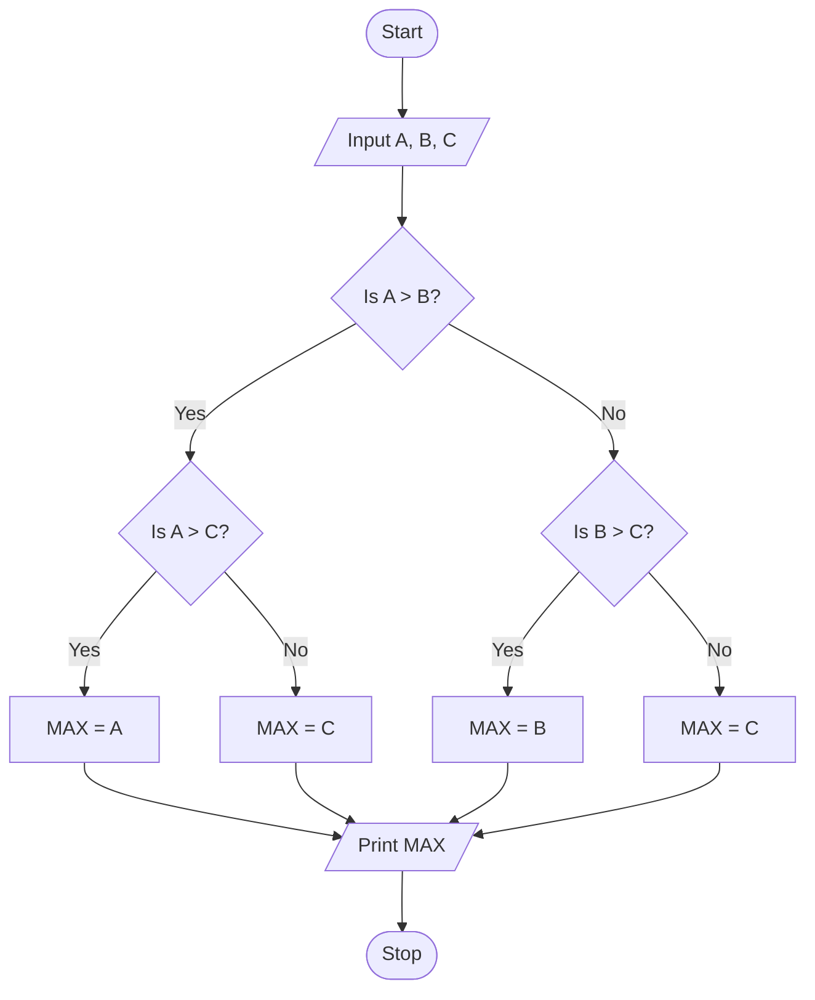

# Unit 2: Computational Thinking and Programming-I (Topics 01–02)

---

## 01. Problem-Solving Methodology & Algorithm Fundamentals

- **Mental model:**
  Think of building a custom house:
  1. **Problem Analysis:** The architect interviews the client to understand what kind of house is needed (how many rooms, budget, soil conditions = inputs, outputs, constraints).
  2. **Algorithm Development:** The architect draws architectural blueprints and step-by-step contractor instructions (the algorithm / pseudocode) before laying a single brick.
  3. **Coding:** The construction crew lays the bricks, pours the concrete, and wires the circuits according to the blueprints using specific building materials (Python syntax).
  4. **Testing:** A building inspector tests the plumbing for leaks, flips every circuit breaker, and checks water pressure under peak load (running test cases to catch defects).
  5. **Debugging:** If the inspector finds water leaking in the basement, the plumber locates the exact broken pipe joint behind the drywall and solders it shut (locating and fixing the root cause).

- **Key facts / definitions (CBSE Standard):**
  - **The 5 Problem-Solving Steps:**
    1. **Analysing the Problem:** Carefully reading and understanding the objective; identifying the input data, boundary conditions, constraints, and expected output format.
    2. **Developing an Algorithm:** Creating an ordered, finite sequence of logical steps to solve the problem. Algorithms are expressed via **pseudocode** or **flowcharts**.
    3. **Coding:** Translating the designed algorithm into high-level programming language code (such as Python) adhering to its syntax and grammatical rules.
    4. **Testing:** Executing the program using diverse sets of test data (valid, boundary/extreme, and invalid inputs) to verify if it produces the correct output and detects hidden defects.
    5. **Debugging:** The investigative process of identifying the exact location and root cause of an identified error (bug) in the source code and modifying the program to eliminate it.
  - **Testing vs Debugging:**
    - *Testing:* Discovering that a defect exists (answers: *"Does the program fail on any input?"*).
    - *Debugging:* Diagnosing why and where the defect occurs, and correcting it (answers: *"Why did it fail, and how do I fix it?"*).
  - **Essential Characteristics of an Algorithm:**
    - **Finiteness:** Must terminate after a finite, countable number of operational steps.
    - **Definiteness:** Every step must be unambiguous, clearly defined, and have only one interpretation.
    - **Inputs:** An algorithm may accept **zero or more** inputs from external sources. (e.g., an algorithm that displays current date or prints the first 100 natural numbers requires 0 external inputs).
    - **Outputs:** An algorithm must produce **at least one** defined output or result. An algorithm with zero outputs is useless.
    - **Effectiveness:** Each operation must be basic and feasible enough to be carried out practically on paper or by a machine in finite time.
    - **Generality:** An algorithm should handle all valid instances of a problem, not just a single hard-coded input set.
  - **Decomposition (Modular Design):**
    - The software engineering principle of breaking down a large, complex, monolithic problem into smaller, self-contained, independent sub-problems (modules, functions, or procedures).
    - *Benefits:*
      1. *Manages Complexity:* Small modules are easier to comprehend, write, trace, and verify.
      2. *Reusability:* Once a sub-module (e.g., computing GCD) is solved, it can be reused multiple times across different programs.
      3. *Parallel Development:* Distinct sub-problems can be assigned to different programmers simultaneously.
      4. *Isolated Debugging:* Errors can be pinpointed and fixed in a specific function without disturbing the rest of the application.

- **Worked example:**
  - **Problem Statement:** Calculate the real roots of a quadratic equation $ax^2 + bx + c = 0$.
  - **1. Analysis:**
    - Inputs: Real coefficients $a, b, c$.
    - Constraints: If $a = 0$, it is linear, not quadratic. If $D = b^2 - 4ac < 0$, real roots do not exist.
    - Outputs: Values of real roots $r_1, r_2$, or an appropriate error message.
  - **2. Algorithm Steps:**
    - Step 1: Input values for $a, b, c$.
    - Step 2: Check if $a == 0$: If yes, display "Not a quadratic equation" and STOP.
    - Step 3: Compute discriminant $D = b^2 - 4ac$.
    - Step 4: Check if $D < 0$: If yes, display "No real roots exist" and STOP.
    - Step 5: If $D == 0$: Compute $r_1 = -b / (2a)$ and display "Roots are equal: ", $r_1$.
    - Step 6: If $D > 0$: Compute $r_1 = (-b + \sqrt{D}) / (2a)$ and $r_2 = (-b - \sqrt{D}) / (2a)$; display "Roots are real and distinct: ", $r_1, r_2$.
    - Step 7: STOP.

- **Common exam mistakes:**
  - Conflating Testing and Debugging (claiming that testing fixes bugs; testing *only exposes* bugs, debugging *fixes* them).
  - Claiming an algorithm requires "at least one input" (algorithms can have zero inputs; but they *must* have at least one output).
  - Overlooking edge cases in analysis (e.g., dividing by zero when $a = 0$).

---

## 02. Representation of Algorithms: Flowcharts and Pseudocode

- **Mental model:**
  - **Flowchart:** The "comic strip / roadmap" of an algorithm. It uses standard geometric shapes connected by arrows so that anyone can visually trace the path of execution, conditional forks, and loops at a glance.
  - **Pseudocode:** The "rough draft / script" of an algorithm. It is written in structured, human-readable English without caring about Python colons, semicolons, brackets, or indentation rules, focusing strictly on computational logic.

- **Key facts / definitions (CBSE Standard):**
  - **Flowchart:** A graphical or diagrammatic representation of the step-by-step sequence of operations required to solve a problem.
  - **Standard Flowchart Symbols (ANSI / ISO Standard):**

| Symbol Name | Geometric Shape | Function & Rules | Example Inside Shape |
|---|---|---|---|
| **Terminal Box** | **Oval** (or rounded rectangle / ellipse) | Indicates the starting point (**Start**) and termination point (**Stop** / **End**) of a program. | `Start` or `Stop` |
| **Input / Output Box** | **Parallelogram** | Represents reading input data into memory or displaying output results to the user. | `Input A, B` or `Print "Max:", M` |
| **Process Box** | **Rectangle** | Represents arithmetic calculations, data manipulation, or assignment of values to variables. | `Sum = A + B` or `Count = 0` |
| **Decision Box** | **Diamond** (Rhombus) | Evaluates a relational or logical condition. Must have **one entry line** and **at least two labeled exit lines** (`Yes`/`No` or `True`/`False`). | `Is A > B?` |
| **Flow Lines** | **Directed Arrows** ($\rightarrow, \leftarrow, \uparrow, \downarrow$) | Indicates the direction and sequence of control execution. Lines should not cross without connectors. | (Connecting arrows) |
| **Connector** | **Small Circle** | Connects different flow lines or joins multiple paths into a single line on the same page to avoid confusing criss-crossing lines. | Labelled letter/number (e.g., `A`) |

  - **Pseudocode:**
    - An artificial, informal language that helps programmers develop algorithms without syntax constraints.
    - Not executable by a computer.
    - Uses standard capitalized control keywords: `INPUT`, `READ`, `COMPUTE`, `CALCULATE`, `PRINT`, `DISPLAY`, `IF`, `THEN`, `ELSE`, `WHILE`, `FOR`, `REPEAT...UNTIL`, `STOP`.

- **Worked example:**
  - **Task:** Algorithm and Flowchart logic to find the largest among three distinct numbers $A$, $B$, and $C$.
  - **Pseudocode:**
    ```text
    START
        INPUT A, B, C
        IF A > B THEN
            IF A > C THEN
                MAX = A
            ELSE
                MAX = C
            ENDIF
        ELSE
            IF B > C THEN
                MAX = B
            ELSE
                MAX = C
            ENDIF
        ENDIF
        PRINT "Largest is: ", MAX
    STOP
    ```
  - **Flowchart Structure (Mermaid Representation):**



- **Common exam mistakes:**
  - Drawing an Input/Output step in a rectangle instead of a **parallelogram**.
  - Drawing a Decision box with only one exit line (a diamond *must* branch into at least two alternative directions with clear labels like `True`/`False` or `Yes`/`No`).
  - Drawing an arrow pointing into an Oval labeled `Start`, or an arrow pointing out of an Oval labeled `Stop`.
  - Claiming pseudocode will throw syntax errors if punctuation is missing (pseudocode is informal English; it cannot be executed or compiled).

